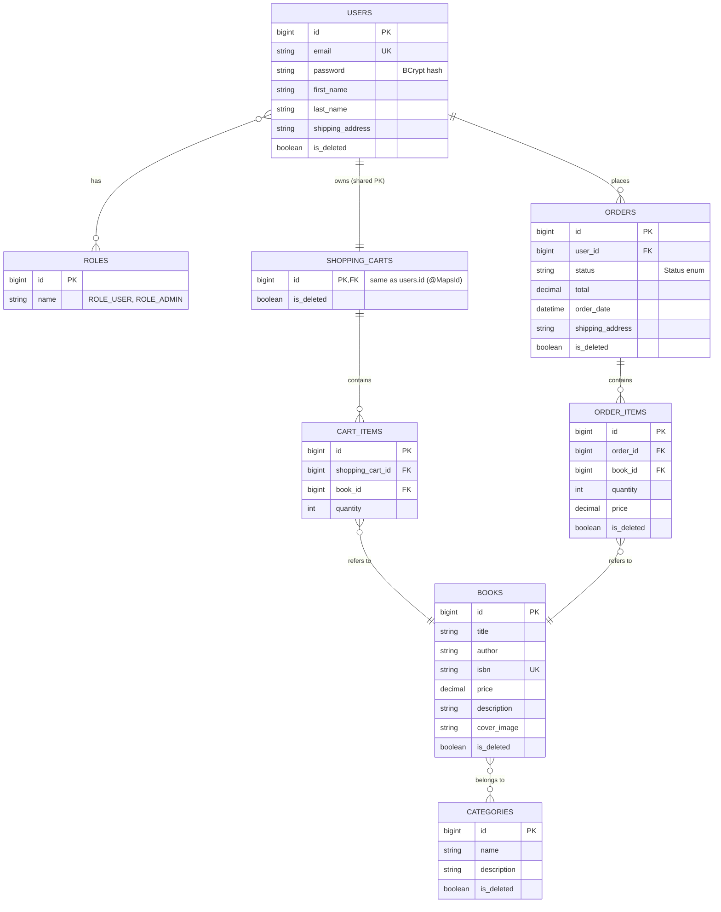

# 📚 Online Book Store

Online Book Store is a RESTful backend application designed to manage an online bookstore. It provides functionality for browsing books, managing a shopping cart, placing orders, and handling user authentication and authorization.

The project demonstrates the development of a backend application using Java and Spring Boot, following a layered architecture and REST API principles.

The main goal of this project is to build a maintainable and secure backend application that supports essential online shopping operations.
## 📜 Table of Contents

- [Project Overview](#project-overview)
- [Technologies Used](#technologies-used)
- [Models and Relations](#models-and-relations)
- [Project Structure](#project-structure)
- [Getting Started](#getting-started)
- [Challenges](#challenges)
- [Postman Collections](#postman-collections)
- [Swagger](#swagger)
- [Contacts](#contacts)

## 📖 Project Overview

Small shops and independent bookstores often lack a simple, secure backend to sell books online. **Online Book Store** solves this by providing a ready-to-use API that covers the full shopping flow:

- registration and login with JWT authentication;
- a catalog of books organized by categories;
- a personal shopping cart created automatically for every new user;
- role-based access: regular users (`ROLE_USER`) shop, administrators (`ROLE_ADMIN`) manage the catalog.

The project was built to practice designing a layered Spring application (controller → service → repository), securing it with Spring Security, and covering it with unit and integration tests.

## ⚒️ Technologies Used

- **Language**:  Java 17+
- **Framework**:  Spring Boot, Spring Web
- **Security**:  Spring Security, JWT (jjwt), BCrypt
- **Persistence**:  Spring Data JPA, Hibernate, MySQL
- **Migrations**:  Liquibase
- **Mapping**: MapStruct, Lombok
- **Validation**: Jakarta Bean Validation
- **API docs**:  Swagger / OpenAPI (springdoc)
- **Testing**:  JUnit 5, Mockito, MockMvc, Testcontainers
- **Build**:  Maven
- **Containers**:  Docker, Docker Compose

## 🗂 Models and Relations



## 📊 Project Structure

### Package layout

```
src/main/java/mate/academy/onlinebookstore
├── config          # Security and application configuration
├── controller      # REST controllers
├── dto             # Request and response DTOs
├── exception       # Custom exceptions and global exception handler
├── mapper          # MapStruct mappers
├── model           # JPA entities
├── repository      # Spring Data repositories
├── security        # JWT utilities and authentication filter
└── service         # Business logic
└── validation      # Custom validation
```

### REST API Endpoints:

### Authentication (public)

- POST `/auth/registration`: Register a new user; a shopping cart is created automatically
- POST `/auth/login`: Authenticate user with email and password and receive a JWT token

### Books

- **GET /books** `ROLE_USER`: List books (with pagination and sorting)
- **GET /books/{id}** `ROLE_USER`: Get a book by id
- **POST /books** `ROLE_ADMIN`: Create a book
- **PUT /books/{id}** `ROLE_ADMIN`: Update a book
- **DELETE /books/{id}** `ROLE_ADMIN`: Delete a book (soft delete)
- **GET /books/search** `ROLE_USER`: Search for books based on provided criteria such as title and author

### Categories

- **GET /categories** `ROLE_USER` : List categories
- **GET /categories/{id}** `ROLE_USER`: Get a category by id
- **GET /categories/{id}/books** `ROLE_USER`:  List books in a category
- **POST /categories** `ROLE_ADMIN`: Create a category
- **PUT /categories/{id}** `ROLE_ADMIN`: Update a category
- **DELETE /categories/{id}** `ROLE_ADMIN`:  Delete a category

### Orders

- **POST /orders** `ROLE_USER`:  Place a new order
- **GET /orders** `ROLE_USER`: Get the order history
- **GET /orders/{orderId}/items** `ROLE_USER`:  Get all items of a specific order
- **GET /orders/{orderId}/items/{id}** `ROLE_USER`: Get detailed information about a specific order item
- **PATCH /orders/{id}** `ROLE_ADMIN`: Update the status of an order

### Shopping Cart (`ROLE_USER`)
- **GET /cart**: Get the current user's shopping cart
- **POST /cart**: Add a book to the cart
- **PUT /cart/items/{cartItemId}**: Update the quantity of a cart item
- **DELETE /cart/items/{cartItemId}**: Remove an item from the cart

## 🚀 Getting Started

### Prerequisites

- JDK 17+
- Maven 3.8+
- Docker and Docker Compose

### 1. Clone the repository

   ```bash
   git clone git@github.com:Tetiana-Hrytsenko/online-book-store.git
   
   cd online-book-store
   ```

Before running the application, you need to set up your environment variables. This project uses
a `.env` file to manage sensitive data and port configurations.

### 2. Configure Environment Variables

- Locate the `.env.template` file in the root directory.
- Create a copy of it and rename it to `.env`:
   ```bash
   cp .env.template .env
   ```
- Open the `.env` file and fill in the required values.

📝 Variable Recommendations

| Variable                | Recommended Value      | Description                                                              |
|:------------------------|:-----------------------|:-------------------------------------------------------------------------|
| **MYSQL_USER**          | `db_user`              | Your application database username.                                      |
| **MYSQL_PASSWORD**      | *your_secure_password* | Password for the application user.                                       |
| **MYSQL_ROOT_PASSWORD** | *root_secure_password* | Administrative password for the MySQL server.                            |
| **MYSQL_DATABASE**      | `app_db`               | Name of the database to be created on startup.                           |
| **MYSQL_LOCAL_PORT**    | `3307`                 | Port on your **Host machine** (use 3307 if 3306 is already in use).      |
| **MYSQL_DOCKER_PORT**   | `3306`                 | Internal MySQL port inside the container (default is 3306).              |
| **SPRING_LOCAL_PORT**   | `8081`                 | Port to access the application from your browser (e.g., localhost:8080). |
| **SPRING_DOCKER_PORT**  | `8080`                 | Internal port where the Spring Boot app runs in Docker.                  |
| **DEBUG_PORT**          | `5005`                 | Port for Remote Debugging from your IDE (IntelliJ, VS Code).             |
| **SECRET**              | `your_jwt_secret`      | Secret key used to sign JWT tokens.                                      |
| **EXPIRATION**          | `3600000`              | JWT token expiration time in milliseconds.             |

### 3. Build the Application

```bash
mvn clean package
```

This command compiles the application, runs the configured tests, and packages it into a JAR file.

### 4. Start the Application with Docker Compose

Once your `.env` file is ready, launch the services using Docker Compose:

```bash
docker compose up --build
```
- This command builds the Docker images for the application and required services.
- It starts the application, database, and any other dependencies inside containers.

Wait for the services to start. You should see logs indicating that the application and database are running.

###  5.Access the Application

1. If you are accessing the application **locally (outside the container)**, use the port defined in `SPRING_LOCAL_PORT`. The application will be accessible at:
``` 
    http://localhost:8081/
```
2. To view the **Swagger API documentation**, navigate to:
``` 
    http://localhost:8081/swagger-ui/index.html
```
For a different port mapping, use the corresponding host port.

### 6. Managing the Application

To run the services in the background:
```bash
docker compose up --build -d
```
To inspect running containers:
```bash
docker compose ps
```
To stop the containers:
```bash
docker compose stop
```
To stop and remove containers, networks, and images:
```bash
docker compose down
```

## 🧗 Challenges

While building this project I faced many challenges, from designing entity relations and
securing the API to writing reliable tests. Most of them were new to me, so every problem
became a chance to learn how Spring works under the hood instead of just making the code run.

Here is how I overcame them:

- **Breaking problems into small steps.** When something failed, I isolated the failing
  layer (controller, service, repository, or security configuration) and checked it on its
  own before looking at the whole application.
- **Reading errors and logs carefully.** Most stack traces pointed to the real cause in the
  last `Caused by` line, and learning to read them saved a lot of time.
- **Writing tests early.** Unit tests with Mockito and integration tests with MockMvc and a
  real database showed me bugs that were invisible when I only tested manually in Postman.
- **Studying the official documentation** of Spring Boot, Spring Security, Hibernate, and
  Liquibase, and using Swagger and Postman to verify the behavior of each endpoint.
- **Asking for feedback and reviewing my own code.** Discussing solutions and rechecking
  my work helped me find weak points, such as missing ownership checks, and fix them.
- **Learning from every mistake.** Each solved issue became a rule I applied later, for
  example keeping secrets in environment variables or checking HTTP statuses in tests.

## 📮 Postman Collections

You can find a Postman collection in `postman/Online-book-store.postman_collection.json`.

To use it:
1. Import the Postman collection into Postman.
2. Configure the API base URL, for example http://localhost:8081.
3. Register a user and authenticate.
4. Use the returned JWT for protected endpoints by selecting Authorization → Bearer Token.
5. Execute the requests and inspect the response status codes and response bodies.

## 📑 Swagger

The project uses Swagger UI to document and explore the REST API.

When the application is running locally, open:

http://localhost:8081/swagger-ui/index.html

The Swagger interface allows you to:

 - Explore available endpoints.
 - Review request parameters and response schemas.
 - Execute API requests directly from the browser.
 - Test authenticated endpoints using a JWT when security is configured for Swagger authorization.

If the application uses another host port, update the URL accordingly.

### API Demo

[Watch the Swagger API demonstration](https://www.loom.com/share/3d85efe9d1cb4325b9ad93d0024ab733)

## ✉️ Contacts

- Author: **Tetiana Hrytsenko**

- Email:  [t.hrytsenko.dev@gmail.com](mailto:t.hrytsenko.dev@gmail.com)

- GitHub: https://github.com/Tetiana-Hrytsenko

Feel free to explore the project or contact me with questions or feedback.
